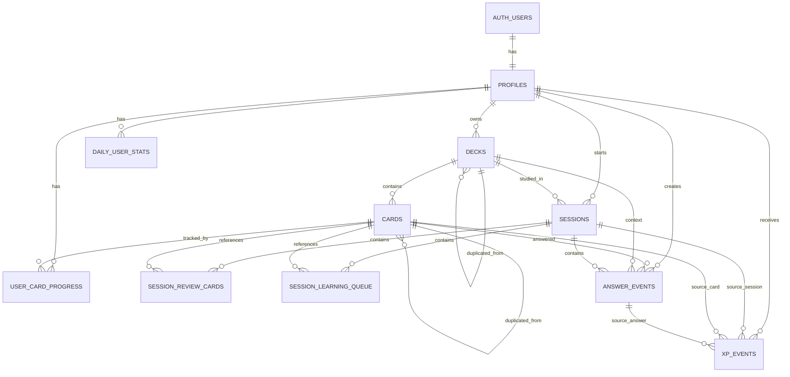

# Vocab Battle — Database Schema

**Version:** 0.1  
**Status:** MVP database design / implementation-ready draft  
**Primary product specification:** `docs/MVP_SPEC_FOR_CLAUDE.md`  
**Supporting product context:** `docs/MVP_OVERVIEW.md`, `docs/MVP_WORKING_NOTES.txt`

> If this document appears to conflict with `MVP_SPEC_FOR_CLAUDE.md`, do not silently choose one. Treat `MVP_SPEC_FOR_CLAUDE.md` as the primary product specification and surface the conflict before implementation.

---

## 1. Design goals

The MVP database must support:

- closed-beta tester accounts (`001`–`030`) and admin (`999`)
- Supabase Auth + Row Level Security
- official starter deck templates
- full deck/card duplication into a user's independent library
- editable/deletable user-owned cards
- per-user card learning state
- `NEW → LEARNING → LEARNED ↔ FORGOTTEN`
- Active Pool selection without storing a separate Active Pool table
- FSRS state and due dates
- review-session queue state
- learning-session cooldown / forced-reappearance state
- resumable sessions
- raw answer-event logging
- battle state
- Daily Goal / streak
- XP / level
- daily aggregate analytics
- weekly/all-time leaderboard calculation
- admin analytics and CSV export
- future deck/community expansion without implementing community features in the MVP

The database should prioritize:

1. **data integrity**
2. **raw-event preservation**
3. **simple MVP behavior**
4. **future extensibility**
5. **minimal duplicated state unless the duplicate is intentional and useful**

---

## 2. Global conventions

### 2.1 IDs

Use UUID primary keys.

Recommended default:

```sql
gen_random_uuid()
```

Exception:

- `profiles.id` should equal the corresponding `auth.users.id`.

---

### 2.2 Timestamps

Use:

```text
TIMESTAMPTZ
```

for timestamps.

Examples:

- `created_at`
- `updated_at`
- `answered_at`
- `started_at`
- `last_seen_at`
- `fsrs_due_at`

Use:

```text
DATE
```

only when the calendar date itself is the meaningful value.

Examples:

- `daily_user_stats.stat_date`
- `profiles.last_daily_goal_completed_on`

All Daily Goal, streak, weekly leaderboard, and day-boundary logic uses:

```text
Asia/Tokyo
```

---

### 2.3 `created_at` / `updated_at`

For mutable tables:

```text
created_at TIMESTAMPTZ NOT NULL DEFAULT now()
updated_at TIMESTAMPTZ NOT NULL DEFAULT now()
```

Use a shared Postgres trigger to update `updated_at` automatically.

Append-only event tables do not need `updated_at`.

Append-only tables:

- `answer_events`
- `xp_events`

---

### 2.4 State values

For MVP state-like columns, prefer:

```text
TEXT + CHECK
```

instead of Postgres ENUMs.

Reason:

- MVP states may still evolve.
- `TEXT + CHECK` is easier to migrate.

---

### 2.5 Soft delete

Do not hard-delete data that would break learning history.

Soft delete pattern:

```text
deleted_at = NULL
```

means active.

```text
deleted_at = <timestamp>
```

means deleted from the user's perspective.

Current soft-delete entities:

- `decks`
- `cards`

---

### 2.6 Archive

Deck archive is separate from deletion.

```text
archived_at = NULL
```

means active in library.

```text
archived_at = <timestamp>
```

means archived.

A deck may be archived without being deleted.

---

### 2.7 Raw logs vs current state vs aggregates

Use three layers:

#### Current state

Examples:

- `profiles`
- `user_card_progress`
- `sessions`

#### Raw append-only history

Examples:

- `answer_events`
- `xp_events`

#### Aggregate/cache tables

Example:

- `daily_user_stats`

Raw history is the authoritative audit trail for beta analysis.

---

## 3. High-level relationship model



---

# 4. Tables

## 4.1 `profiles`

Stores current account-level state.

`profiles.id` must match `auth.users.id`.

### Columns

| Column | Type | Default | Null | Notes |
|---|---|---:|---|---|
| `id` | UUID | — | NO | PK. References `auth.users.id` |
| `public_user_id` | TEXT | — | NO | User-facing beta ID, e.g. `001`, `999` |
| `role` | TEXT | `tester` | NO | `tester` / `admin` |
| `account_status` | TEXT | `active` | NO | `active` / `disabled` |
| `exclude_from_analytics` | BOOLEAN | `false` | NO | Admin/QA exclusion flag |
| `nickname` | TEXT | NULL | YES | User-facing display name |
| `onboarding_completed` | BOOLEAN | `false` | NO | First-login flow completed |
| `selected_deck_id` | UUID | NULL | YES | Currently selected user-owned deck |
| `total_xp` | INTEGER | `0` | NO | Current cumulative XP |
| `level` | INTEGER | `1` | NO | Current level |
| `current_streak` | INTEGER | `0` | NO | Daily Goal streak |
| `longest_streak` | INTEGER | `0` | NO | Historical max streak |
| `total_enemies_defeated` | INTEGER | `0` | NO | Lifetime enemy defeats |
| `last_daily_goal_completed_on` | DATE | NULL | YES | Asia/Tokyo calendar date |
| `first_active_at` | TIMESTAMPTZ | NULL | YES | First **START SESSION** time |
| `last_active_at` | TIMESTAMPTZ | NULL | YES | Last meaningful product activity |
| `disabled_at` | TIMESTAMPTZ | NULL | YES | Account disable timestamp |
| `disabled_reason` | TEXT | NULL | YES | Optional admin reason |
| `created_at` | TIMESTAMPTZ | `now()` | NO | |
| `updated_at` | TIMESTAMPTZ | `now()` | NO | Auto-update trigger |

### Constraints

```text
PRIMARY KEY (id)

UNIQUE (public_user_id)

nickname must be case-insensitive UNIQUE when non-null

CHECK role IN ('tester', 'admin')

CHECK account_status IN ('active', 'disabled')

CHECK total_xp >= 0
CHECK level >= 1
CHECK current_streak >= 0
CHECK longest_streak >= 0
CHECK total_enemies_defeated >= 0
```

Implementation note for case-insensitive nickname uniqueness:

- use `citext`, or
- a unique index on `lower(nickname)` where `nickname IS NOT NULL`.

### Foreign keys

```text
id
→ auth.users.id

selected_deck_id
→ decks.id
→ ON DELETE SET NULL
```

### Analytics rule

Beta analytics must include only users satisfying:

```text
role = 'tester'
AND exclude_from_analytics = false
```

Admin `999`:

```text
role = 'admin'
exclude_from_analytics = true
```

Admin may preview/test the learning UI, but preview interactions must not be written into production learner tables such as:

- `sessions`
- `answer_events`
- `user_card_progress`
- `daily_user_stats`
- `xp_events`

---

## 4.2 `decks`

Stores both official template decks and user-owned duplicated decks.

The MVP uses a **Template → Duplicate → Independent Copy** model.

Once duplicated, a user's deck is independent from its source.

### Columns

| Column | Type | Default | Null | Notes |
|---|---|---:|---|---|
| `id` | UUID | `gen_random_uuid()` | NO | PK |
| `name` | TEXT | — | NO | Editable for user-owned decks |
| `description` | TEXT | NULL | YES | |
| `front_language` | TEXT | — | NO | MVP: English |
| `back_language` | TEXT | — | NO | MVP: Japanese |
| `owner_user_id` | UUID | NULL | YES | NULL for official templates |
| `source_deck_id` | UUID | NULL | YES | Deck this deck was duplicated from |
| `is_template` | BOOLEAN | `false` | NO | Can be used as duplication source |
| `is_official` | BOOLEAN | `false` | NO | Official Vocab Battle content |
| `visibility` | TEXT | `private` | NO | `private` / `unlisted` / `public` |
| `sort_order` | INTEGER | `0` | NO | User library ordering |
| `archived_at` | TIMESTAMPTZ | NULL | YES | Archive timestamp |
| `deleted_at` | TIMESTAMPTZ | NULL | YES | Soft delete timestamp |
| `created_at` | TIMESTAMPTZ | `now()` | NO | |
| `updated_at` | TIMESTAMPTZ | `now()` | NO | Auto-update trigger |

### Constraints

```text
CHECK length(trim(name)) > 0
CHECK visibility IN ('private', 'unlisted', 'public')
CHECK sort_order >= 0
```

Deck names are **not unique**.

### Foreign keys

```text
owner_user_id
→ profiles.id
→ ON DELETE RESTRICT

source_deck_id
→ decks.id
→ ON DELETE SET NULL
```

### Official starter deck example

```text
owner_user_id = NULL
source_deck_id = NULL
is_template = true
is_official = true
visibility = 'public'
```

### User-owned duplicate example

```text
owner_user_id = <tester UUID>
source_deck_id = <official template deck UUID>
is_template = false
is_official = false
visibility = 'private'
```

### MVP visibility behavior

Although `visibility` supports future community functionality:

- official templates are readable by testers
- user-owned decks are private to the owner
- user-created public/unlisted sharing is **not implemented in the MVP**

Do not treat `visibility = public` alone as authorization for community access until community RLS is explicitly designed.

---

## 4.3 `cards`

Stores cards belonging directly to one deck.

The MVP does **not** use a `deck_cards` join table.

When a deck is duplicated, all cards are duplicated with new card IDs.

### Columns

| Column | Type | Default | Null | Notes |
|---|---|---:|---|---|
| `id` | UUID | `gen_random_uuid()` | NO | PK |
| `deck_id` | UUID | — | NO | Owning deck |
| `front` | TEXT | — | NO | MVP: English |
| `back` | TEXT | — | NO | MVP: Japanese |
| `extra_content` | JSONB | `{}` | NO | Future example sentence, notes, image metadata, etc. |
| `created_by_user_id` | UUID | NULL | YES | NULL for official template cards |
| `source_card_id` | UUID | NULL | YES | Original card if duplicated |
| `sort_order` | INTEGER | `0` | NO | Deck ordering |
| `created_at` | TIMESTAMPTZ | `now()` | NO | |
| `updated_at` | TIMESTAMPTZ | `now()` | NO | Auto-update trigger |
| `deleted_at` | TIMESTAMPTZ | NULL | YES | Soft delete |

### Constraints

```text
CHECK length(trim(front)) > 0
CHECK length(trim(back)) > 0
CHECK sort_order >= 0
```

Card content is **not unique**.

The same word/meaning may exist in multiple decks or copies.

### Foreign keys

```text
deck_id
→ decks.id
→ ON DELETE RESTRICT

created_by_user_id
→ profiles.id
→ ON DELETE RESTRICT

source_card_id
→ cards.id
→ ON DELETE SET NULL
```

### Future tags

Do not put production tags inside `extra_content` if tags later become searchable/filterable first-class data.

Future approach:

```text
tags
card_tags
```

---

## 4.4 `user_card_progress`

Stores the current learning/retention state for one user and one card.

This is separate from `cards`.

### Columns

| Column | Type | Default | Null | Notes |
|---|---|---:|---|---|
| `id` | UUID | `gen_random_uuid()` | NO | PK |
| `user_id` | UUID | — | NO | |
| `card_id` | UUID | — | NO | |
| `card_status` | TEXT | `NEW` | NO | `NEW`, `LEARNING`, `LEARNED`, `FORGOTTEN` |
| `seen_count` | INTEGER | `0` | NO | Total study exposures |
| `correct_streak` | INTEGER | `0` | NO | Current consecutive Correct |
| `wrong_streak` | INTEGER | `0` | NO | Current consecutive Wrong |
| `last_seen_at` | TIMESTAMPTZ | NULL | YES | |
| `last_answer_correct` | BOOLEAN | NULL | YES | Previous user judgment |
| `first_mastered_at` | TIMESTAMPTZ | NULL | YES | First time card became LEARNED |
| `last_mastered_at` | TIMESTAMPTZ | NULL | YES | Most recent mastery/re-mastery |
| `fsrs_due_at` | TIMESTAMPTZ | NULL | YES | Next FSRS review |
| `fsrs_stability` | DOUBLE PRECISION | NULL | YES | FSRS state |
| `fsrs_difficulty` | DOUBLE PRECISION | NULL | YES | FSRS state |
| `fsrs_elapsed_days` | INTEGER | `0` | NO | FSRS state |
| `fsrs_scheduled_days` | INTEGER | `0` | NO | FSRS state |
| `fsrs_reps` | INTEGER | `0` | NO | FSRS state |
| `fsrs_lapses` | INTEGER | `0` | NO | FSRS state |
| `fsrs_learning_steps` | INTEGER | `0` | NO | FSRS state |
| `fsrs_state` | INTEGER | NULL | YES | Internal FSRS state |
| `fsrs_last_review_at` | TIMESTAMPTZ | NULL | YES | |
| `created_at` | TIMESTAMPTZ | `now()` | NO | |
| `updated_at` | TIMESTAMPTZ | `now()` | NO | Auto-update trigger |

### Constraints

```text
UNIQUE (user_id, card_id)

CHECK card_status IN ('NEW', 'LEARNING', 'LEARNED', 'FORGOTTEN')

CHECK seen_count >= 0
CHECK correct_streak >= 0
CHECK wrong_streak >= 0

CHECK fsrs_elapsed_days >= 0
CHECK fsrs_scheduled_days >= 0
CHECK fsrs_reps >= 0
CHECK fsrs_lapses >= 0
CHECK fsrs_learning_steps >= 0
```

### Foreign keys

```text
user_id
→ profiles.id
→ ON DELETE RESTRICT

card_id
→ cards.id
→ ON DELETE RESTRICT
```

### Indexes

```text
INDEX (user_id, card_status)

INDEX (user_id, fsrs_due_at)
```

### Important distinction

```text
card_status
```

is the Vocab Battle product lifecycle:

```text
NEW → LEARNING → LEARNED ↔ FORGOTTEN
```

```text
fsrs_state
```

is internal FSRS state.

They must remain separate.

### Mastery

Learning card becomes `LEARNED` when:

```text
correct_streak >= 4
AND
seen_count >= 5
```

First mastery:

```text
first_mastered_at = now()
last_mastered_at = now()
```

Re-mastery:

```text
first_mastered_at = unchanged
last_mastered_at = now()
```

### Active Pool

Do **not** store:

- `in_active_pool`
- a dedicated Active Pool table

Active Pool is calculated from current user-card state.

Priority:

```text
1. FORGOTTEN
2. existing LEARNING
3. NEW as refill
```

Target size:

```text
ACTIVE_POOL_TARGET_SIZE ≈ 30
```

The exact selection algorithm belongs in application/session logic.

---

## 4.5 `sessions`

Represents one session from **START SESSION** until explicit completion.

Review and Learning are modes inside the same session.

### Columns

| Column | Type | Default | Null | Notes |
|---|---|---:|---|---|
| `id` | UUID | `gen_random_uuid()` | NO | PK |
| `user_id` | UUID | — | NO | |
| `deck_id` | UUID | — | NO | Selected deck |
| `status` | TEXT | `active` | NO | `active` / `completed` |
| `started_at` | TIMESTAMPTZ | `now()` | NO | |
| `ended_at` | TIMESTAMPTZ | NULL | YES | |
| `last_active_at` | TIMESTAMPTZ | `now()` | NO | |
| `active_duration_sec` | INTEGER | `0` | NO | Active learning time, excluding idle time |
| `resume_count` | INTEGER | `0` | NO | |
| `end_reason` | TEXT | NULL | YES | `user_finished` / `timeout` / `error` |
| `current_mode` | TEXT | — | NO | `review` / `learning` |
| `started_with_reviews` | BOOLEAN | `false` | NO | |
| `reviews_completed_at` | TIMESTAMPTZ | NULL | YES | |
| `learning_draw_index` | INTEGER | `0` | NO | Counts Learning draws only |
| `current_enemy_type` | TEXT | NULL | YES | Enemy identifier |
| `current_enemy_max_hp` | INTEGER | NULL | YES | |
| `current_enemy_hp` | INTEGER | NULL | YES | |
| `current_combo` | INTEGER | `0` | NO | |
| `total_answers` | INTEGER | `0` | NO | |
| `correct_answers` | INTEGER | `0` | NO | |
| `wrong_answers` | INTEGER | `0` | NO | |
| `enemies_defeated` | INTEGER | `0` | NO | Session count |
| `longest_combo` | INTEGER | `0` | NO | |
| `critical_hits` | INTEGER | `0` | NO | |
| `xp_gained` | INTEGER | `0` | NO | |
| `daily_goal_progress` | INTEGER | `0` | NO | Snapshot for resume |
| `daily_goal_completed` | BOOLEAN | `false` | NO | |
| `continued_after_daily_goal` | BOOLEAN | `false` | NO | |
| `created_at` | TIMESTAMPTZ | `now()` | NO | |
| `updated_at` | TIMESTAMPTZ | `now()` | NO | Auto-update trigger |

### Constraints

```text
CHECK status IN ('active', 'completed')

CHECK current_mode IN ('review', 'learning')

CHECK end_reason IS NULL
   OR end_reason IN ('user_finished', 'timeout', 'error')

CHECK active_duration_sec >= 0
CHECK resume_count >= 0
CHECK learning_draw_index >= 0

CHECK current_enemy_max_hp IS NULL OR current_enemy_max_hp >= 0
CHECK current_enemy_hp IS NULL OR current_enemy_hp >= 0
CHECK current_combo >= 0

CHECK total_answers >= 0
CHECK correct_answers >= 0
CHECK wrong_answers >= 0
CHECK enemies_defeated >= 0
CHECK longest_combo >= 0
CHECK critical_hits >= 0
CHECK xp_gained >= 0
CHECK daily_goal_progress >= 0
```

### Foreign keys

```text
user_id
→ profiles.id
→ ON DELETE RESTRICT

deck_id
→ decks.id
→ ON DELETE RESTRICT
```

### Indexes

```text
INDEX (user_id, status)

INDEX (user_id, last_active_at)
```

### Resume behavior

Closing the app does **not** complete the session.

If the app is closed:

```text
status remains 'active'
```

On next app launch:

- detect unfinished active session
- show previous session stats
- offer:
  - Resume
  - Finish

Resume restores:

- current enemy
- enemy max/current HP
- combo
- session XP
- session enemy count
- Daily Goal progress
- learning draw index

The card that was visible but unanswered at app close is **not restored**.

No `answer_event` is created for that unanswered card.

Resume continues with a newly drawn next card.

---

## 4.6 `session_review_cards`

Stores per-session review-queue state.

Review queue is fixed at review-portion start.

Cards that become due after the review portion begins are not added to the current review queue.

### Columns

| Column | Type | Default | Null | Notes |
|---|---|---:|---|---|
| `id` | UUID | `gen_random_uuid()` | NO | PK |
| `session_id` | UUID | — | NO | |
| `card_id` | UUID | — | NO | |
| `queue_order` | INTEGER | — | NO | Current order |
| `wrong_count` | INTEGER | `0` | NO | Wrong count in this review portion |
| `completed` | BOOLEAN | `false` | NO | |
| `completed_at` | TIMESTAMPTZ | NULL | YES | |
| `created_at` | TIMESTAMPTZ | `now()` | NO | |
| `updated_at` | TIMESTAMPTZ | `now()` | NO | Auto-update trigger |

### Constraints

```text
UNIQUE (session_id, card_id)

CHECK queue_order >= 0
CHECK wrong_count >= 0
```

### Foreign keys

```text
session_id
→ sessions.id
→ ON DELETE CASCADE

card_id
→ cards.id
→ ON DELETE RESTRICT
```

### Behavior

Correct:

```text
completed = true
completed_at = now()
```

First Wrong in the same review portion:

```text
wrong_count = 1
move card to back of queue
```

Second Wrong in the same review portion:

```text
wrong_count = 2
card_status = FORGOTTEN
completed = true
completed_at = now()
```

The card then becomes eligible for the Learning Active Pool.

Previous FSRS history/state must be preserved.

---

## 4.7 `session_learning_queue`

Stores per-session Learning-mode cooldown/reappearance state.

This is **not** the Active Pool.

### Columns

| Column | Type | Default | Null | Notes |
|---|---|---:|---|---|
| `id` | UUID | `gen_random_uuid()` | NO | PK |
| `session_id` | UUID | — | NO | |
| `card_id` | UUID | — | NO | |
| `last_draw_index` | INTEGER | NULL | YES | Last Learning draw position |
| `next_eligible_draw_index` | INTEGER | NULL | YES | Correct-answer cooldown |
| `forced_reappear_draw_index` | INTEGER | NULL | YES | Wrong-answer forced reappearance |
| `times_shown_in_session` | INTEGER | `0` | NO | |
| `last_result` | TEXT | NULL | YES | `correct` / `wrong` |
| `created_at` | TIMESTAMPTZ | `now()` | NO | |
| `updated_at` | TIMESTAMPTZ | `now()` | NO | Auto-update trigger |

### Constraints

```text
UNIQUE (session_id, card_id)

CHECK last_draw_index IS NULL OR last_draw_index >= 0
CHECK next_eligible_draw_index IS NULL OR next_eligible_draw_index >= 0
CHECK forced_reappear_draw_index IS NULL OR forced_reappear_draw_index >= 0
CHECK times_shown_in_session >= 0

CHECK last_result IS NULL
   OR last_result IN ('correct', 'wrong')
```

### Foreign keys

```text
session_id
→ sessions.id
→ ON DELETE CASCADE

card_id
→ cards.id
→ ON DELETE RESTRICT
```

### Behavior

`learning_draw_index` belongs to `sessions` and counts only Learning draws.

Review cards do not increment it.

Correct at Learning draw `N`:

```text
next_eligible_draw_index = N + 11
```

Therefore the card cannot appear in the next 10 Learning draws.

Clear any previous forced reappearance.

Wrong at Learning draw `N`:

```text
gap = random integer 6..9
forced_reappear_draw_index = N + gap
```

If that forced position is already reserved:

```text
shift the newly scheduled card forward
until an unreserved position is found
```

Rows are created only when a card is first used in that session.

Do not pre-create rows for the entire Active Pool.

This state survives session interruption/resume.

---

## 4.8 `answer_events`

Append-only raw event log.

**One answer = one row.**

Do not update or delete normal answer events after insertion.

### Columns

| Column | Type | Default | Null | Notes |
|---|---|---:|---|---|
| `id` | UUID | `gen_random_uuid()` | NO | PK |
| `client_event_id` | UUID | — | NO | Idempotency key |
| `user_id` | UUID | — | NO | |
| `card_id` | UUID | — | NO | |
| `deck_id` | UUID | — | NO | |
| `session_id` | UUID | — | NO | |
| `answered_at` | TIMESTAMPTZ | `now()` | NO | |
| `correct` | BOOLEAN | — | NO | User choice |
| `response_time_ms` | INTEGER | — | NO | Front shown → Show Answer |
| `session_mode` | TEXT | — | NO | `review` / `learning` |
| `card_seen_count_at_answer` | INTEGER | — | NO | Pre-answer state |
| `correct_streak_before` | INTEGER | — | NO | |
| `wrong_streak_before` | INTEGER | — | NO | |
| `previous_answer` | BOOLEAN | NULL | YES | Previous answer Correct? |
| `card_status_before` | TEXT | — | NO | |
| `time_since_last_seen` | BIGINT | NULL | YES | Milliseconds |
| `previous_review_interval` | INTEGER | NULL | YES | Days where applicable |
| `card_status_after` | TEXT | — | NO | |
| `correct_streak_after` | INTEGER | — | NO | |
| `wrong_streak_after` | INTEGER | — | NO | |
| `fsrs_rating` | TEXT | NULL | YES | Internal rating |
| `fsrs_due_before` | TIMESTAMPTZ | NULL | YES | |
| `fsrs_due_after` | TIMESTAMPTZ | NULL | YES | |
| `base_damage` | INTEGER | `0` | NO | |
| `speed_bonus` | INTEGER | `0` | NO | |
| `combo` | INTEGER | `0` | NO | Combo applied/recorded for event |
| `damage` | INTEGER | `0` | NO | Final damage |
| `critical` | BOOLEAN | `false` | NO | |
| `enemy_hp_before` | INTEGER | NULL | YES | |
| `enemy_hp_after` | INTEGER | NULL | YES | |
| `created_at` | TIMESTAMPTZ | `now()` | NO | Insert timestamp |

### Constraints

```text
UNIQUE (client_event_id)

CHECK response_time_ms >= 0

CHECK session_mode IN ('review', 'learning')

CHECK card_seen_count_at_answer >= 0
CHECK correct_streak_before >= 0
CHECK wrong_streak_before >= 0
CHECK correct_streak_after >= 0
CHECK wrong_streak_after >= 0

CHECK card_status_before IN ('NEW', 'LEARNING', 'LEARNED', 'FORGOTTEN')
CHECK card_status_after  IN ('NEW', 'LEARNING', 'LEARNED', 'FORGOTTEN')

CHECK fsrs_rating IS NULL
   OR fsrs_rating IN ('Again', 'Hard', 'Good', 'Easy')

CHECK base_damage >= 0
CHECK speed_bonus >= 0
CHECK combo >= 0
CHECK damage >= 0
```

### Foreign keys

```text
user_id
→ profiles.id
→ ON DELETE RESTRICT

card_id
→ cards.id
→ ON DELETE RESTRICT

deck_id
→ decks.id
→ ON DELETE RESTRICT

session_id
→ sessions.id
→ ON DELETE RESTRICT
```

### Indexes

```text
INDEX (user_id, answered_at)

INDEX (session_id, answered_at)
```

### Response-time rule

`response_time_ms` measures:

```text
front displayed
→ user taps Show Answer
```

Do not include:

- time spent reading the revealed answer
- time spent deciding Correct/Wrong after reveal

---

## 4.9 `daily_user_stats`

One row per user per Asia/Tokyo calendar day.

This is an aggregate/cache table, not the raw source of truth.

### Columns

| Column | Type | Default | Null | Notes |
|---|---|---:|---|---|
| `id` | UUID | `gen_random_uuid()` | NO | PK |
| `user_id` | UUID | — | NO | |
| `stat_date` | DATE | — | NO | Asia/Tokyo |
| `first_activity_at` | TIMESTAMPTZ | NULL | YES | |
| `last_activity_at` | TIMESTAMPTZ | NULL | YES | |
| `active_duration_sec` | INTEGER | `0` | NO | |
| `session_count` | INTEGER | `0` | NO | |
| `total_answers` | INTEGER | `0` | NO | |
| `correct_answers` | INTEGER | `0` | NO | |
| `wrong_answers` | INTEGER | `0` | NO | |
| `cards_mastered` | INTEGER | `0` | NO | Mastery + re-mastery count for day |
| `cards_forgotten` | INTEGER | `0` | NO | |
| `reviews_due` | INTEGER | `0` | NO | Review cards due for the day/session logic |
| `reviews_completed` | INTEGER | `0` | NO | |
| `enemies_defeated` | INTEGER | `0` | NO | |
| `critical_hits` | INTEGER | `0` | NO | |
| `longest_combo` | INTEGER | `0` | NO | |
| `xp_gained` | INTEGER | `0` | NO | Net daily XP change |
| `daily_goal_completed` | BOOLEAN | `false` | NO | |
| `daily_goal_completed_at` | TIMESTAMPTZ | NULL | YES | |
| `continued_after_daily_goal` | BOOLEAN | `false` | NO | |
| `post_goal_answers` | INTEGER | `0` | NO | |
| `created_at` | TIMESTAMPTZ | `now()` | NO | |
| `updated_at` | TIMESTAMPTZ | `now()` | NO | Auto-update trigger |

### Constraints

```text
UNIQUE (user_id, stat_date)

CHECK active_duration_sec >= 0
CHECK session_count >= 0

CHECK total_answers >= 0
CHECK correct_answers >= 0
CHECK wrong_answers >= 0

CHECK cards_mastered >= 0
CHECK cards_forgotten >= 0
CHECK reviews_due >= 0
CHECK reviews_completed >= 0

CHECK enemies_defeated >= 0
CHECK critical_hits >= 0
CHECK longest_combo >= 0
CHECK post_goal_answers >= 0
```

`xp_gained` may be negative if an admin adjustment produces a net negative daily change.

### Foreign key

```text
user_id
→ profiles.id
→ ON DELETE RESTRICT
```

The unique `(user_id, stat_date)` constraint also provides an index for that key.

---

## 4.10 `xp_events`

Append-only XP ledger.

Stores **why** XP changed.

### Columns

| Column | Type | Default | Null | Notes |
|---|---|---:|---|---|
| `id` | UUID | `gen_random_uuid()` | NO | PK |
| `user_id` | UUID | — | NO | XP recipient |
| `session_id` | UUID | NULL | YES | |
| `card_id` | UUID | NULL | YES | |
| `source_answer_event_id` | UUID | NULL | YES | Idempotent source |
| `amount` | INTEGER | — | NO | Positive or negative |
| `reason` | TEXT | — | NO | |
| `performed_by_user_id` | UUID | NULL | YES | Admin adjustment actor |
| `note` | TEXT | NULL | YES | Optional adjustment note |
| `created_at` | TIMESTAMPTZ | `now()` | NO | |

### Allowed reasons

```text
correct_answer
card_learned
card_relearned
enemy_defeated
daily_goal_completed
admin_adjustment
```

### Constraints

```text
CHECK reason IN (
  'correct_answer',
  'card_learned',
  'card_relearned',
  'enemy_defeated',
  'daily_goal_completed',
  'admin_adjustment'
)
```

Idempotency constraint:

```text
UNIQUE (source_answer_event_id, reason)
```

Postgres allows multiple NULL values in a UNIQUE constraint, which is acceptable for non-answer-based admin adjustments.

### Foreign keys

```text
user_id
→ profiles.id
→ ON DELETE RESTRICT

session_id
→ sessions.id
→ ON DELETE SET NULL

card_id
→ cards.id
→ ON DELETE SET NULL

source_answer_event_id
→ answer_events.id
→ ON DELETE SET NULL

performed_by_user_id
→ profiles.id
→ ON DELETE SET NULL
```

---

# 5. Starter deck duplication model

The MVP uses full duplication, not overrides.

Do **not** implement:

- `user_decks`
- `user_card_overrides`
- `deck_cards`

for the MVP.

Flow:

```text
Official Starter Deck Template
        ↓ duplicate
User-owned independent Deck
        ↓
100 duplicated Cards
        ↓
100 user_card_progress rows
```

On first onboarding:

1. user chooses one starter deck
2. selected official template is duplicated
3. all 100 cards are duplicated with new UUIDs
4. each duplicated card gets:
   - `source_card_id = official source card`
5. duplicated deck gets:
   - `source_deck_id = official source deck`
6. create one `user_card_progress` row per duplicated card:
   - `card_status = NEW`
   - `seen_count = 0`
   - streaks = 0
7. set:
   - `profiles.selected_deck_id = duplicated deck ID`

Only the selected starter deck is duplicated during first onboarding.

The other starter deck remains available to add later.

After duplication, changes to the user's deck/cards do not affect:

- official templates
- other users
- the source card/deck

---

# 6. Authentication model

## 6.1 Public beta UX

Tester IDs:

```text
001–030
```

Admin ID:

```text
999
```

Login UI:

```text
User ID
Password
```

No public registration.

No tester email-address registration.

No tester email-verification flow.

No tester email password-reset flow in the beta.

If a tester forgets a password:

```text
Admin resets it.
```

---

## 6.2 Supabase Auth

Supabase Auth manages credentials.

Never store plaintext or hashed passwords in application tables.

`profiles.id` maps to:

```text
auth.users.id
```

The internal mapping from public ID to Supabase Auth credential may use an implementation-only identifier such as a synthetic internal email, but:

- it must never be shown to testers
- testers must never need to type it
- the public UX remains ID + Password

---

## 6.3 Admin

Admin `999`:

```text
role = 'admin'
exclude_from_analytics = true
```

Admin may:

- access `/admin`
- read beta tester analytics
- export data
- disable/reactivate accounts
- perform password resets
- perform explicit XP adjustments
- perform explicitly designed recovery actions

Admin must **not** have unrestricted edit access to raw learner history.

Admin may preview/test learner UI, but preview mode must not persist beta learner records.

---

# 7. Row Level Security

Enable RLS on all application tables.

## 7.1 Read rules

### Tester

Tester may read:

- own `profiles` row
- own user-owned decks
- official template decks
- cards belonging to own decks
- cards belonging to official templates
- own `user_card_progress`
- own `sessions`
- own `answer_events`
- own `daily_user_stats`
- own `xp_events`
- `session_review_cards` belonging to own sessions
- `session_learning_queue` belonging to own sessions

Tester may not read:

- another tester's private deck
- another tester's card progress
- another tester's sessions
- another tester's answer events
- another tester's private analytics

### Admin

Admin may read all beta data required by `/admin`.

---

## 7.2 Write rules

### `profiles`

Tester may update only explicitly permitted self-editable profile fields, such as nickname.

Do not allow testers to directly modify:

- role
- account_status
- exclude_from_analytics
- total_xp
- level
- streak fields
- analytics/control fields

Those are changed through trusted application/admin logic.

### `decks`

Tester may create/update/soft-delete only owned decks.

Tester may not modify official template decks.

### `cards`

Tester may create/update/soft-delete cards only inside owned decks.

Tester may not modify official template cards.

### Trusted-state tables (`user_card_progress`, `sessions`, `session_review_cards`, `session_learning_queue`, `answer_events`, `daily_user_stats`, `xp_events`)

These seven tables are **SELECT-only for the `authenticated` Postgres role** (tester and admin alike): no direct `INSERT`/`UPDATE`/`DELETE` grant exists on them at all. This is stricter than "tester may write own rows" -- ownership scoping alone is not enough, because every state change here is one step of a larger atomic, multi-table operation (see section 10), and letting the client issue arbitrary partial writes would break that atomicity and the append-only/idempotency guarantees.

All mutation of these tables happens exclusively through trusted database/application workflows:

- `duplicate_starter_deck()` -- creates the initial `user_card_progress` rows for a newly duplicated deck
- `start_or_resume_session()` -- creates/resumes `sessions` rows and seeds the fixed review queue in `session_review_cards`
- `finish_session()` -- completes the caller's own `sessions` row
- `commit_answer_transaction()` -- the only writer of `answer_events` and `xp_events`, and the primary writer of `user_card_progress`, `session_review_cards`, `session_learning_queue`, and `daily_user_stats` per answer

See section 10 for the full workflow definitions.

`answer_events` and `xp_events` remain append-only in the stricter sense too: no policy or grant permits `UPDATE`/`DELETE` on them under any circumstance, including for admin.

Hard delete is not part of normal product behavior for any of the seven.

Admin XP adjustments (`xp_events.reason = 'admin_adjustment'`, which also affects `daily_user_stats.xp_gained`) must go through explicit admin logic, not a direct write -- admin has no broader write access to these tables than tester.

---

# 8. Indexes

Use indexes that support the MVP's frequent queries.

## `user_card_progress`

```text
INDEX (user_id, card_status)

INDEX (user_id, fsrs_due_at)
```

Use cases:

- build Active Pool
- find due review cards

## `cards`

```text
INDEX (deck_id, deleted_at)

INDEX (deck_id, sort_order)
```

## `sessions`

```text
INDEX (user_id, status)

INDEX (user_id, last_active_at)
```

## `answer_events`

```text
INDEX (user_id, answered_at)

INDEX (session_id, answered_at)
```

Do not create redundant indexes when a UNIQUE constraint already provides an equivalent index.

---

# 9. Derived data — do not create dedicated tables/columns unnecessarily

## 9.1 Active Pool

No Active Pool table.

Calculate from:

```text
user_card_progress
+
cards in selected deck
```

Priority:

```text
FORGOTTEN
LEARNING
NEW
```

Target:

```text
~30 cards
```

---

## 9.2 Leaderboard

No `leaderboards` table in the MVP.

### Weekly

Calculate from:

```text
daily_user_stats.enemies_defeated
```

for the current Asia/Tokyo week beginning Monday 00:00.

Exclude:

```text
role != 'tester'
OR exclude_from_analytics = true
```

### All-time

Rank using:

```text
profiles.total_enemies_defeated
```

with the same analytics exclusion.

Tie behavior:

```text
5th
5th
7th
```

competition ranking.

---

## 9.3 Accuracy

Do not store global accuracy in `profiles`.

Calculate from:

```text
correct_answers / total_answers
```

or raw events depending on the requested scope.

---

## 9.4 Card-status counts

Do not store:

- new card count
- learning card count
- learned card count

in `profiles`.

Calculate from:

```text
user_card_progress.card_status
```

---

## 9.5 Duplicate counts

Do not store `duplicate_count`.

Calculate from:

```text
decks.source_deck_id
cards.source_card_id
```

when needed.

---

# 10. Transaction and idempotency requirements

Critical multi-table state changes must be atomic.

Use Postgres transactions / trusted database functions where appropriate.

If one step fails:

```text
rollback the entire operation
```

---

## 10.1 `duplicate_starter_deck()`

Purpose:

Create an independent user-owned copy of an official starter deck.

Caller: `authenticated` (a direct Postgres RPC callable by the signed-in tester). Derives the acting user from `auth.uid()` internally -- see section 10.6.

### Required behavior

Within one transaction:

1. validate authenticated active tester
2. validate source deck is an allowed starter/template deck
3. detect whether this tester already has the relevant starter copy for the MVP flow
4. if an existing valid copy exists:
   - return it
   - do not duplicate again
5. insert duplicated user-owned deck
6. copy all source cards with new UUIDs
7. set `source_card_id` on copies
8. create one `user_card_progress` row per copied card
9. initialize each progress row:
   - `NEW`
   - counts/streaks = 0
10. update `profiles.selected_deck_id`
11. commit

On any failure:

```text
rollback everything
```

Do not trust a client-supplied user UUID.

Resolve the authenticated user from Supabase Auth (`auth.uid()`), never from a request parameter.

---

## 10.2 Session workflows: `start_or_resume_session()` and `finish_session()`

`sessions`, along with `session_review_cards` and `session_learning_queue`, is SELECT-only for `authenticated` (section 7.2): the client cannot INSERT/UPDATE a session row directly. Starting, resuming, and completing a session are each a trusted workflow instead.

### `start_or_resume_session()`

Purpose:

Start a new session, or resume the caller's existing unfinished one, as one atomic operation.

Caller: `authenticated`. Derives the acting user from `auth.uid()` internally -- see section 10.6.

Within one transaction:

1. validate authenticated active tester
2. resolve the acting user from `auth.uid()`, never from client input
3. look for an existing `sessions` row for this user with `status = 'active'`
4. if one exists:
   - resume it per the Resume behavior in section 4.5 (current enemy, HP, combo, session XP, enemy count, Daily Goal progress, learning draw index)
   - do not restore the card that was visible but unanswered at last close (section 4.5)
   - return it
5. otherwise:
   - validate the requested deck belongs to the caller (or is a valid selected deck)
   - insert a new `sessions` row (`status = 'active'`, `current_mode`, `started_with_reviews`, etc.)
   - determine the review queue for this session (cards currently due) and insert the fixed set of `session_review_cards` rows per section 4.6 -- this queue is not touched again after this point even if more cards become due mid-session
   - return the new session
6. commit

On any failure:

```text
rollback everything
```

### `finish_session()`

Purpose:

Safely complete the caller's own active session.

Caller: `authenticated`. Trusted workflow scoped to the caller's own session -- validates `sessions.user_id = auth.uid()` before mutating anything; see section 10.6.

Within one transaction:

1. validate authenticated active tester
2. validate the target session belongs to the caller and is `status = 'active'`
3. set `status = 'completed'`, `ended_at = now()`, and `end_reason`
4. commit

On any failure:

```text
rollback everything
```

---

## 10.3 Answer submission architecture

Purpose:

Process one Correct/Wrong answer as one atomic operation, without reimplementing FSRS or the rating estimator inside Postgres.

### Layered architecture

```text
Browser
  -> trusted Next.js server-side submitAnswer()
  -> rating estimator + ts-fsrs + battle/XP calculations, in TypeScript
  -> commit_answer_transaction() Postgres RPC
  -> atomic persistence
```

The internal FSRS rating estimator (section 16 of `MVP_SPEC_FOR_CLAUDE.md`) and `ts-fsrs` itself (section 11.4) run in the trusted Next.js server-side `submitAnswer()` function, in TypeScript, before the database is touched. **Postgres must not reimplement FSRS or the rating estimator.** `commit_answer_transaction()` receives already-computed values (FSRS rating, updated FSRS state/due date, battle result) and is responsible only for atomic, idempotent persistence of those values -- not for deriving them.

### `commit_answer_transaction()`

Purpose:

Atomically persist the result of one already-computed answer as one Postgres transaction.

Security (see also section 10.6):

- **not** executable by `PUBLIC`, `anon`, or `authenticated` -- no `EXECUTE` grant exists for any of those roles
- intended only for a future server-only privileged caller (the trusted Next.js server-side runtime, invoked through a dedicated, minimally-privileged execution path -- not the end user's own `authenticated` session)
- accepts the target user id as an explicit parameter supplied by that trusted server path, since it does not run inside the end user's own authenticated Postgres session and therefore cannot derive the user from `auth.uid()`
- independently re-verifies, inside the function body, that the supplied session belongs to the supplied user and is `active`, that the card belongs to the session's deck/current flow, and that the user's `user_card_progress` row for that card belongs to the same user -- ownership is never assumed just because the caller is privileged
- preserves `client_event_id` idempotency (`answer_events.client_event_id` is UNIQUE; a retried event returns the existing result rather than reprocessing)
- rolls back the entire transaction on any failure

### Idempotency

Client generates:

```text
client_event_id UUID
```

per answer, passed through the whole chain (`submitAnswer()` -> `commit_answer_transaction()`).

`answer_events.client_event_id` is UNIQUE.

If the same event is submitted again because of:

- double tap
- network retry
- client retry

do not process it twice.

Return the already-processed result where practical.

### Required transaction flow (`commit_answer_transaction()`)

Within one transaction:

1. validate the supplied session belongs to the supplied user and is `active`
2. reject admin preview from production learner persistence
3. validate card belongs to the session deck / valid current flow
4. check `client_event_id`
5. if already processed:
   - return existing result
6. capture pre-answer state
7. persist the Correct/Wrong effects already determined upstream:
   - seen count
   - correct/wrong streaks
   - last answer
   - last seen
8. apply Mastery / Forgotten lifecycle rules
9. persist the FSRS rating and updated FSRS state/due date computed upstream by `ts-fsrs` (do not compute them here)
10. update either:
   - `session_review_cards`
   - or `session_learning_queue`
11. persist the battle result computed upstream:
   - base damage
   - speed bonus
   - combo
   - critical
   - final damage
   - enemy HP
   - enemy defeat / respawn
12. insert `answer_events`
13. update session aggregates/state
14. update daily aggregate state
15. insert XP events as applicable
16. update `profiles.total_xp`
17. update level
18. if Daily Goal becomes complete:
   - mark Daily Goal complete exactly once
   - award Daily Goal XP exactly once
   - update streak exactly once
   - update `last_daily_goal_completed_on`
   - update `longest_streak` if needed
19. commit

On any failure:

```text
rollback everything
```

---

## 10.4 XP idempotency

For XP generated by an answer:

```text
UNIQUE (source_answer_event_id, reason)
```

Examples from one answer:

```text
correct_answer
card_learned
enemy_defeated
daily_goal_completed
```

may each exist once.

---

## 10.5 Daily Goal idempotency

Daily Goal completion is based on Asia/Tokyo day boundaries.

Never increment:

- streak
- Daily Goal XP

more than once for the same user/date.

Use:

- `daily_user_stats.daily_goal_completed`
- `profiles.last_daily_goal_completed_on`

as part of the guard.

Daily Goal target:

```text
5 enemies
```

---

## 10.6 `SECURITY DEFINER` requirements

Every trusted database function above (`is_admin()`, `duplicate_starter_deck()`, `start_or_resume_session()`, `finish_session()`, `commit_answer_transaction()`) that needs to read or write beyond what the calling role's own RLS policies allow must be defined `SECURITY DEFINER`, and each one must satisfy all of the following:

- **fixed `search_path`**: set `search_path = ''` (or another fixed, non-caller-influenced value) on the function definition, so a lower-privileged role cannot hijack name resolution by creating an object earlier in a mutable search path
- **schema qualification**: every table, view, and function referenced in the body is schema-qualified (e.g. `public.profiles`, `auth.uid()`), consistent with the fixed `search_path`
- **independent ownership/authorization checks inside the function body**: a `SECURITY DEFINER` function runs as its owner and therefore bypasses the caller's RLS policies -- it must not rely on RLS to enforce who can do what. Each function re-validates the relevant ownership (session belongs to user, card belongs to deck, progress row belongs to user, etc.) explicitly, using either `auth.uid()` (for functions callable by `authenticated`) or the trusted caller-supplied user id (for `commit_answer_transaction()`, which cannot use `auth.uid()` -- see section 10.3)
- **minimum `EXECUTE` grants**: `REVOKE ALL` from `PUBLIC` first, then `GRANT EXECUTE` only to the specific role(s) that should be able to call it -- `authenticated` for `is_admin()`, `duplicate_starter_deck()`, `start_or_resume_session()`, and `finish_session()`; no grant to `PUBLIC`, `anon`, or `authenticated` for `commit_answer_transaction()`, whose caller is a future server-only privileged role instead

---

# 11. Learning and review behavior relevant to data

## 11.1 Mastery

```text
correct_streak >= 4
AND
seen_count >= 5
→ LEARNED
```

---

## 11.2 Review → Forgotten

Within one review portion:

```text
first Wrong
→ reinsert later in review queue

second Wrong
→ FORGOTTEN
→ completed in review queue
→ eligible for Learning Active Pool
```

Do not reset accumulated FSRS history/state.

After re-mastery:

```text
FORGOTTEN → LEARNED
```

and retention continues from accumulated FSRS history.

---

## 11.3 Learning cooldown

Correct:

```text
cannot appear in next 10 Learning draws
```

Wrong:

```text
must reappear 6–9 Learning draws later
```

If forced positions collide:

```text
later reservation shifts forward until free
```

---

## 11.4 FSRS

Use `ts-fsrs`.

Initial configuration belongs in central app configuration:

```text
request_retention = 0.90
enable_fuzz = true
enable_short_term = true
```

User never manually selects:

- Again
- Hard
- Good
- Easy

Internal estimator maps Correct/Wrong + behavior to one rating.

Store the resulting rating in:

```text
answer_events.fsrs_rating
```

---

# 12. Daily analytics behavior

`daily_user_stats` is updated using Asia/Tokyo day boundaries.

It supports calculation of:

- D1 / D3 / D7 return
- Daily Goal Completion Rate
- Post-Goal Continuation Rate
- Session Duration
- Answers per Session
- Review Due Completion Rate
- Accuracy by seen count
- Response Time by seen count
- Average exposures until mastery
- Forgotten rate
- Wrong → next attempt correct rate
- Enemies Defeated
- Longest Combo
- XP gained
- Levels reached

### D1 / D3 / D7 origin

Do not use account creation time.

Use:

```text
profiles.first_active_at
```

where `first_active_at` is set when the user starts their first real learning session.

---

# 13. Tables intentionally not included in MVP

Do not create the following unless a later requirement explicitly needs them.

```text
user_decks
user_card_overrides
deck_cards
active_pool
leaderboards
content_events
tags
card_tags
```

Reasoning:

- user decks/cards are full independent duplicates
- Active Pool is derived
- leaderboard is calculated
- content audit log is not required for MVP
- tags are future scope

---

# 14. Admin / analytics exclusions

All beta analytics must exclude:

```text
role = 'admin'
```

and any account where:

```text
exclude_from_analytics = true
```

This applies to:

- retention calculations
- D1/D3/D7
- accuracy
- session metrics
- Daily Goal metrics
- leaderboard
- beta-success analysis

Admin preview/test activity must not contaminate learner datasets.

---

# 15. Migration / implementation expectations

Claude Code should implement the schema through version-controlled Supabase migrations rather than relying only on manual dashboard table creation.

After each stable milestone:

1. run migrations
2. verify schema
3. verify RLS
4. verify relevant database writes
5. run application build/tests
6. commit to Git

Do not commit:

- `.env.local`
- database passwords
- Supabase secret/service-role keys

---

# 16. Implementation order for database work

Recommended order:

1. shared extensions / helper functions
2. `profiles`
3. `decks`
4. `cards`
5. `user_card_progress`
6. `sessions`
7. `session_review_cards`
8. `session_learning_queue`
9. `answer_events`
10. `daily_user_stats`
11. `xp_events`
12. indexes
13. updated-at trigger
14. RLS
15. starter template seed data
16. `duplicate_starter_deck()`
17. `start_or_resume_session()`
18. `finish_session()`
19. `commit_answer_transaction()` (invoked by the trusted Next.js server-side `submitAnswer()`; see section 10.3)
20. integration tests / data-integrity tests

---

# 17. Database acceptance checks

Before considering the schema implementation complete, verify at minimum:

- tester cannot read another tester's private data
- tester cannot modify official template decks/cards
- admin can read beta data but is excluded from analytics
- admin preview does not write production learner history
- starter deck duplication produces:
  - 1 user-owned deck
  - 100 independent card copies
  - 100 NEW progress rows
- re-running starter duplication does not create unintended duplicates
- `authenticated` has no direct INSERT/UPDATE/DELETE grant on any trusted-state table (section 7.2); all mutation of those tables happens only via `duplicate_starter_deck()`, `start_or_resume_session()`, `finish_session()`, and `commit_answer_transaction()`
- `commit_answer_transaction()` is not executable by `PUBLIC`, `anon`, or `authenticated` -- only by the future trusted server-only caller (section 10.3)
- FSRS state and the internal rating estimator are computed in the trusted Next.js server-side `submitAnswer()` (TypeScript), never reimplemented in Postgres
- answer retry with same `client_event_id` does not double-process
- answer submission is atomic
- XP cannot be double-awarded for the same answer/reason
- Daily Goal XP/streak cannot be double-awarded on one JST date
- raw answer events are append-only
- Card/Deck soft deletion preserves historical references
- session interruption can be resumed
- Review wrong count survives resume
- Learning cooldown/reappearance state survives resume
- LEARNED/FORGOTTEN transitions behave correctly
- FSRS history is not reset when a card becomes FORGOTTEN
- due-review query is efficient
- Active Pool query is efficient
- beta analytics exclude admin/test-excluded accounts

---

# 18. Final design principle

The database should support a simple user experience:

> Choose a deck, press Start Session, fight enemies, and let the app decide what to study next.

The database may be complex internally, but:

- review scheduling
- FSRS state
- queue mechanics
- transaction logic
- analytics instrumentation

should remain mostly invisible to the learner.
